<div align="center">

# 💊 Droguería y Variedades Los Tres Hermanos

**Tienda web para una droguería de Arjona, Bolívar (Colombia): catálogo de medicamentos y variedades, pedidos por WhatsApp, planes de suscripción con descuento y panel de administración.**


[Capturas](#-capturas) · [Funcionalidades](#-funcionalidades) · [Arquitectura](#-arquitectura) · [Instalación](#-instalación-y-ejecución) · [Seguridad](#-seguridad) · [Limitaciones](#%EF%B8%8F-limitaciones-actuales)

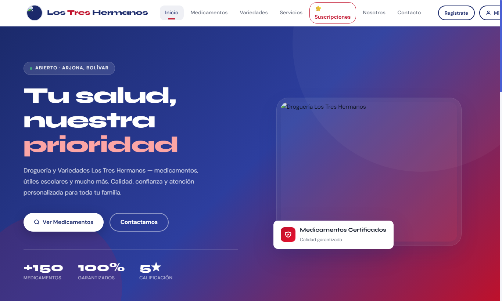

</div>

## 📌 Sobre el proyecto

Este proyecto de aula lleva a la web la atención de una droguería de barrio. Un cliente puede explorar los productos, armar su carrito, elegir entre domicilio o recoger en tienda y enviar el pedido a la droguería por WhatsApp. El pago del pedido se hace en efectivo al recibirlo.

Los clientes también pueden suscribirse a un plan mensual para obtener descuentos. El administrador revisa los comprobantes de pago y activa los planes desde su panel.

> [!IMPORTANT]
> El proyecto todavía no tiene base de datos: las cuentas, los pedidos y las suscripciones se guardan en el navegador. Sirve para demostraciones y para fines académicos, pero aún no está listo para clientes reales. Consulta las [limitaciones actuales](#%EF%B8%8F-limitaciones-actuales).

## 📸 Capturas

> [!NOTE]
> Las capturas son de la aplicación real con **datos ficticios**. El logo y las fotos de productos todavía no están en el repositorio; por eso se ven huecos y tarjetas con el nombre del producto.

### Catálogo

| Medicamentos | Variedades |
|:---:|:---:|
| 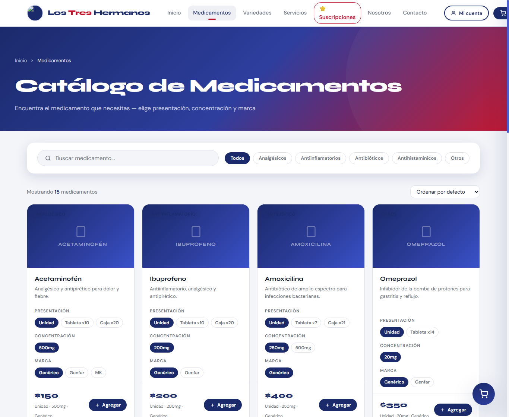 | 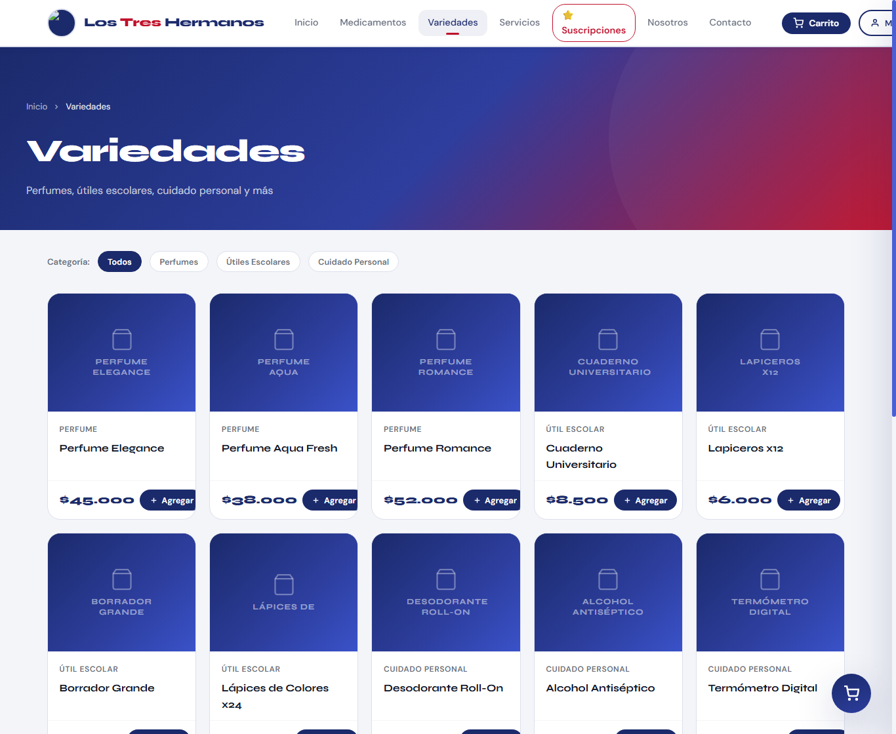 |
| Búsqueda, filtros y selección de presentación, concentración y marca | Perfumes, útiles escolares y cuidado personal |

### Suscripciones y cuenta del cliente

| Planes de suscripción | Registro | Mi cuenta |
|:---:|:---:|:---:|
| 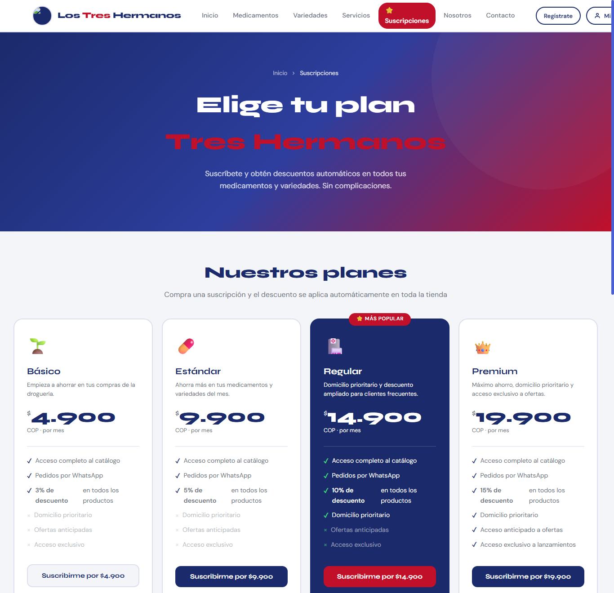 | 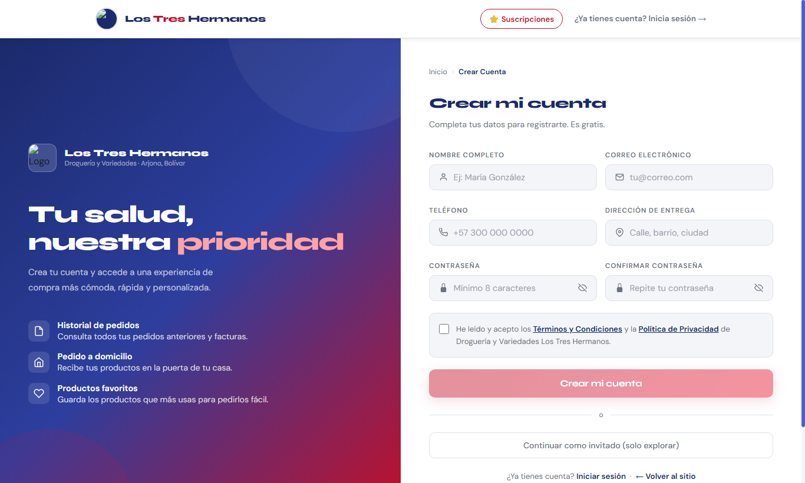 | 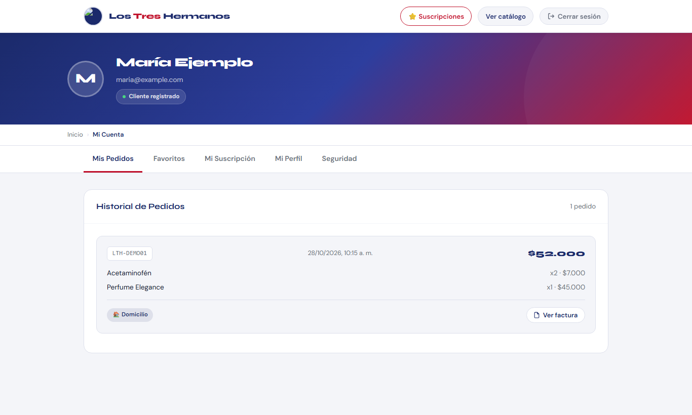 |

### Panel de administración

| Acceso | Resumen | Revisión de un pago |
|:---:|:---:|:---:|
| 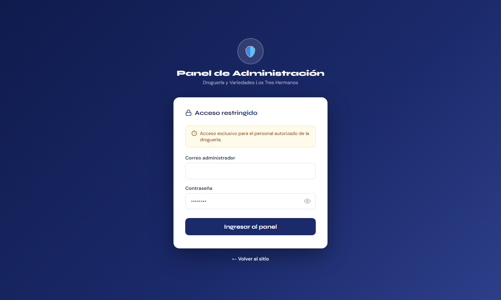 | 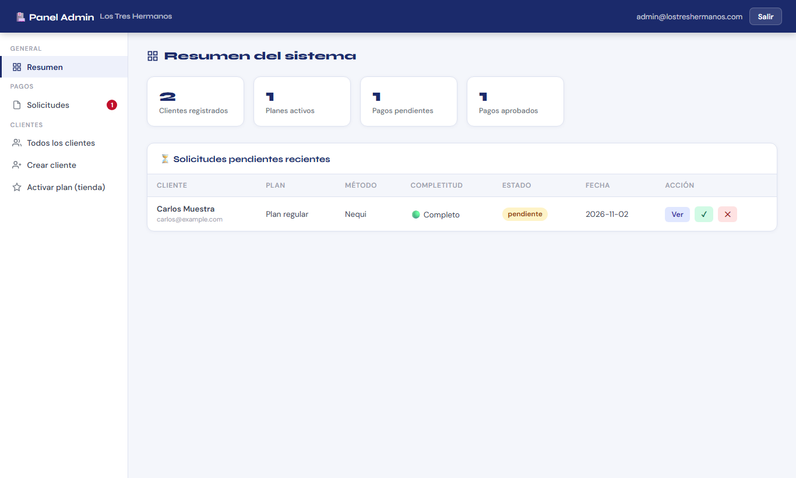 | 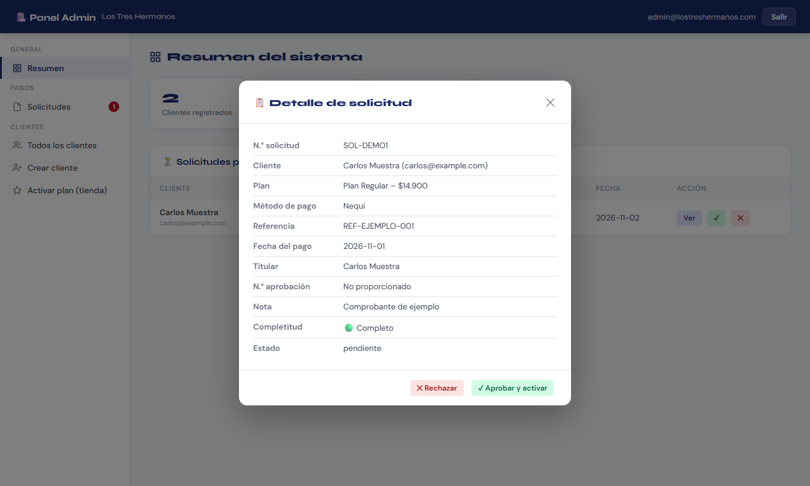 |

## ✨ Funcionalidades

### Para clientes

- 🔎 **Catálogo:** medicamentos con búsqueda, filtros por categoría y orden, además de variedades por categoría.
- 🛒 **Carrito y pedido:** carrito persistente, entrega a domicilio o recogida en tienda, y envío del pedido por WhatsApp.
- 🧾 **Recibo e historial:** comprobante del pedido y consulta de compras anteriores desde **Mi cuenta**.
- ⭐ **Suscripciones:** descuento automático en toda la tienda cuando el plan está aprobado y vigente.
- 💳 **Pago de planes:** Nequi, Daviplata, PSE, Bancolombia o efectivo en tienda, con envío de comprobante.
- 👤 **Cuenta personal:** edición de datos, cambio de correo y contraseña, y eliminación de la cuenta.

### Para administradores

- 📊 **Resumen:** clientes registrados, planes activos y pagos pendientes o aprobados.
- ✅ **Pagos:** revisión de comprobantes y aprobación o rechazo de solicitudes.
- 👥 **Clientes:** búsqueda y creación de cuentas.
- 🏪 **Pagos en tienda:** activación manual del plan cuando el cliente paga en efectivo.

### Planes de suscripción

| Plan | Precio mensual | Descuento | Domicilio prioritario | Ofertas anticipadas y acceso exclusivo |
|---|---:|:---:|:---:|:---:|
| 🌱 Básico | $4.900 COP | 3 % | — | — |
| 💊 Estándar | $9.900 COP | 5 % | — | — |
| 🏥 Regular | $14.900 COP | 10 % | ✅ | — |
| 👑 Premium | $19.900 COP | 15 % | ✅ | ✅ |

## 🛠️ Tecnologías

| Capa | Tecnología |
|---|---|
| Lenguaje | Java 21 |
| Framework | Spring Boot 4.1 (Spring MVC) |
| Seguridad | Spring Security y BCrypt en el servidor; PBKDF2 con Web Crypto en el navegador |
| Vistas | Thymeleaf, HTML5, CSS3 y JavaScript sin frameworks |
| Almacenamiento actual | `localStorage` y `sessionStorage` del navegador |
| Construcción | Maven (incluye Maven Wrapper) |
| Pruebas | JUnit 5, Spring MockMvc y Spring Security Test |

## 🏗️ Arquitectura

El servidor entrega las páginas y protege el panel de administración. La lógica de negocio de los clientes se ejecuta hoy en el navegador.

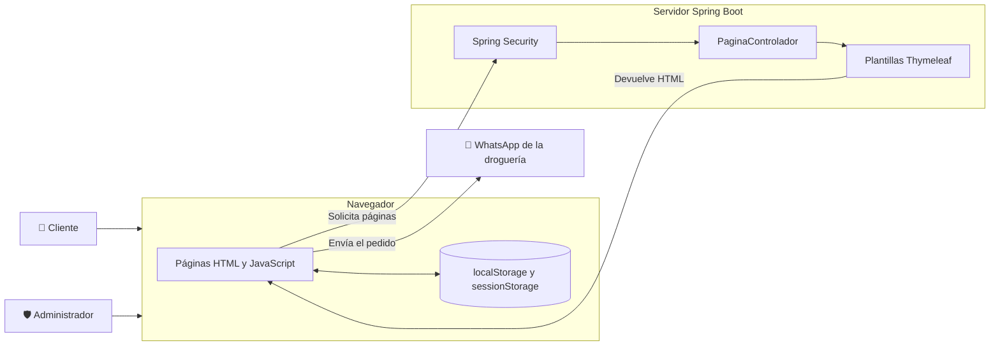

### Flujo de una suscripción

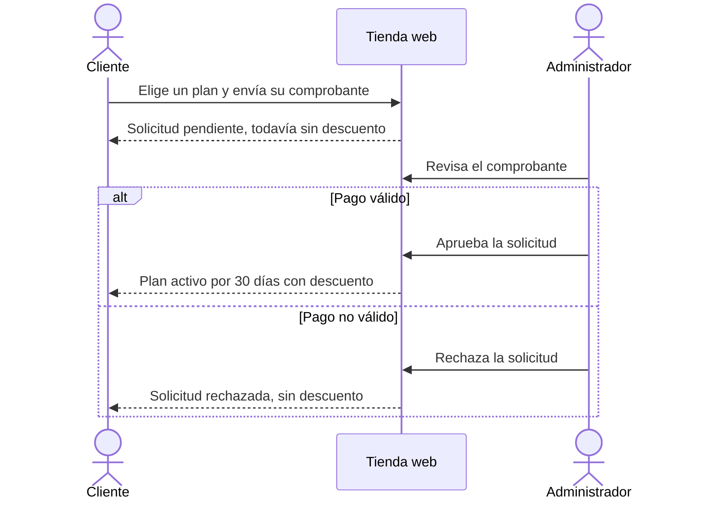

### Estructura del proyecto

```text
.
├── docs/imagenes/                  # Capturas de este README
├── pom.xml                         # Dependencias y construcción
└── src
    ├── main
    │   ├── java/com/example/DrogueriaLosTresHermanos
    │   │   ├── configuracion/      # Spring Security y límite de intentos de login
    │   │   ├── controlador/        # Rutas y vistas (MVC)
    │   │   ├── controller/         # Referencia histórica, sin uso
    │   │   └── modelo/             # Cliente, Producto, Pedido, ItemPedido y PlanSuscripcion
    │   └── resources
    │       ├── application.properties
    │       ├── static
    │       │   ├── css/global.css
    │       │   └── js/             # global.js, seguridad.js y explorador-data.js
    │       └── templates/          # Páginas Thymeleaf
    └── test/java/...               # Pruebas automatizadas
```

### Rutas

| Ruta | Página | Acceso |
|---|---|---|
| `/` | Inicio | Público |
| `/medicamentos`, `/variedades` | Catálogos | Público |
| `/servicios`, `/nosotros`, `/contacto` | Información de la droguería | Público |
| `/suscripciones` | Planes | Público |
| `/registro`, `/login` | Cuenta de cliente | Público |
| `/perfil`, `/checkout`, `/recibo`, `/pago-suscripcion` | Área del cliente | Con sesión de cliente, comprobada en el navegador |
| `/admin/login` | Acceso de administrador | Público |
| `/admin` | Panel de administración | **Protegido por el servidor** |

## 🚀 Instalación y ejecución

### Requisitos

- [JDK 21 o superior](https://adoptium.net/). No hace falta instalar Maven, porque el proyecto incluye Maven Wrapper.

### Pasos

**1. Clona el repositorio**

```bash
git clone https://github.com/jhean1/DrogueriaYvariedadesLosTresHermanos.git
cd DrogueriaYvariedadesLosTresHermanos
```

**2. Define la clave del administrador** (mínimo 12 caracteres)

```powershell
# Windows (PowerShell)
$env:ADMIN_CLAVE = "escribe-aqui-una-clave-larga-y-unica"
```

```bash
# Linux o macOS
export ADMIN_CLAVE="escribe-aqui-una-clave-larga-y-unica"
```

Si no la defines, la aplicación genera una clave temporal en cada arranque y la muestra en la consola.

**3. Inicia la aplicación**

```powershell
# Windows
.\mvnw.cmd spring-boot:run
```

```bash
# Linux o macOS
./mvnw spring-boot:run
```

**4. Abre el sitio**

- Tienda: <http://localhost:8081>
- Panel de administración: <http://localhost:8081/admin/login>

> [!NOTE]
> El registro y el inicio de sesión de clientes usan una función del navegador disponible solo en `localhost` o HTTPS. No funcionan desde otro dispositivo por `http://192.168.x.x`.

### Variables de entorno

| Variable | Descripción | Valor por defecto |
|---|---|---|
| `ADMIN_CORREO` | Correo para entrar al panel | `admin@lostreshermanos.com` |
| `ADMIN_CLAVE` | Clave del administrador (12 caracteres o más) | Se genera una temporal en cada arranque |
| `COOKIE_SEGURA` | Usa `true` si el sitio funciona con HTTPS | `false` |

### Pruebas

```powershell
.\mvnw.cmd test    # En Linux o macOS: ./mvnw test
```

## 🔒 Seguridad

| Medida | Qué protege |
|---|---|
| Credenciales en variables de entorno y BCrypt | Evita que la clave del administrador aparezca en el código |
| Sesión en el servidor para `/admin` | Impide entrar al panel sin autenticarse |
| Protección CSRF | Rechaza formularios de login y cierre de sesión enviados desde otros sitios |
| Bloqueo tras 5 intentos fallidos durante 15 minutos | Frena los ataques de fuerza bruta contra el panel |
| Hash PBKDF2-SHA256 con sal | Evita guardar las contraseñas de clientes en texto plano |
| Escape de datos en HTML | Reduce el riesgo de XSS con nombres o pedidos manipulados |
| Lista de rutas de retorno permitidas | Evita redirecciones a sitios externos después del login |
| Tabla oficial de planes | Impide aprobar un plan con precio o descuento alterados |
| CSP y otras cabeceras de seguridad | Limitan scripts externos y el envío de datos a otros dominios, y evitan que el sitio se inserte en otras páginas |

## ⚠️ Limitaciones actuales

- **Sin base de datos:** cada navegador tiene sus propios datos. El panel de administración solo ve la información guardada en el navegador donde se abre.
- **Las cuentas de cliente no se validan en el servidor:** una persona con conocimientos técnicos puede modificar su sesión o sus datos desde las herramientas del navegador.
- **Precios sin verificación en el servidor:** el contenido del carrito se puede alterar antes de enviarlo por WhatsApp, por lo que la droguería debe confirmar cada pedido.
- **La CSP permite scripts en línea:** las plantillas actuales los necesitan.
- **Imágenes pendientes:** faltan el logo y las fotos de los productos.
- **Datos de pago de ejemplo:** revisa los números de cuenta y el NIT antes de cualquier uso real.

## 🗺️ Próximos pasos

- [ ] Agregar el logo y las fotos de los productos.
- [ ] Mejorar el diseño en celulares y corregir detalles visuales.
- [ ] Incorporar una base de datos y una API en el servidor.
- [ ] Validar cuentas, precios, pedidos y suscripciones en el servidor.
- [ ] Publicar el sitio con HTTPS.

## 🌿 Ramas

| Rama | Propósito |
|---|---|
| `master` | Versión principal del proyecto |
| `frontend` | Mejoras de diseño e interfaz |

## 👤 Autor

Desarrollado por [**@jhean1**](https://github.com/jhean1) como proyecto de aula.

---

<div align="center">

Droguería y Variedades Los Tres Hermanos · Arjona, Bolívar, Colombia

</div>
