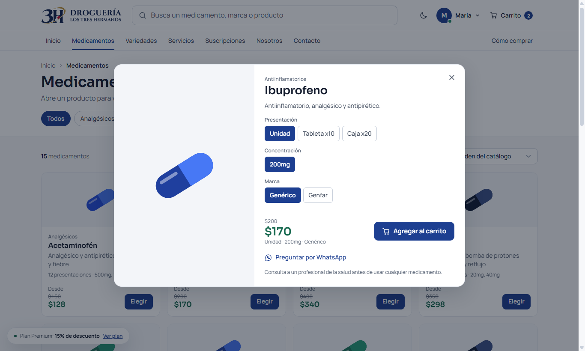
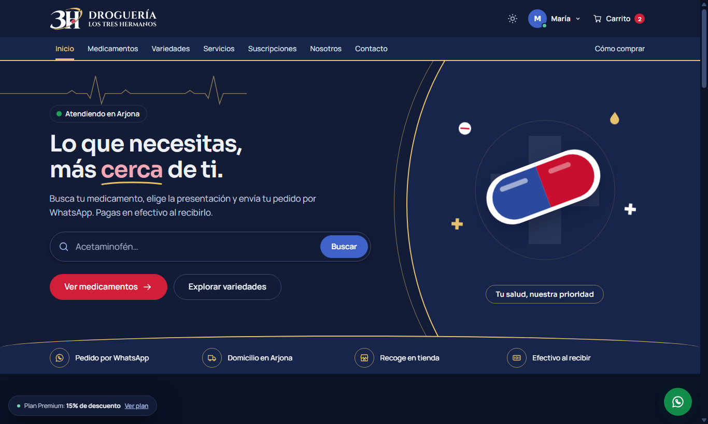
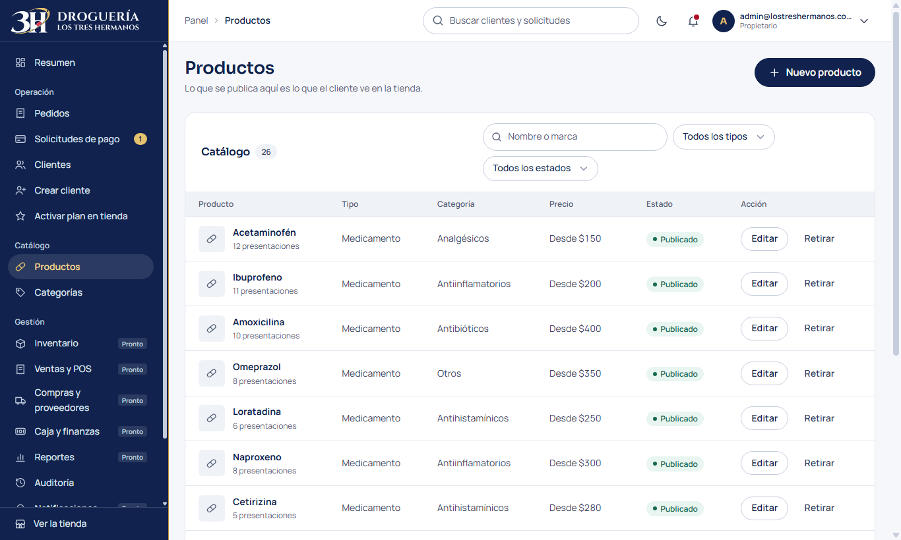
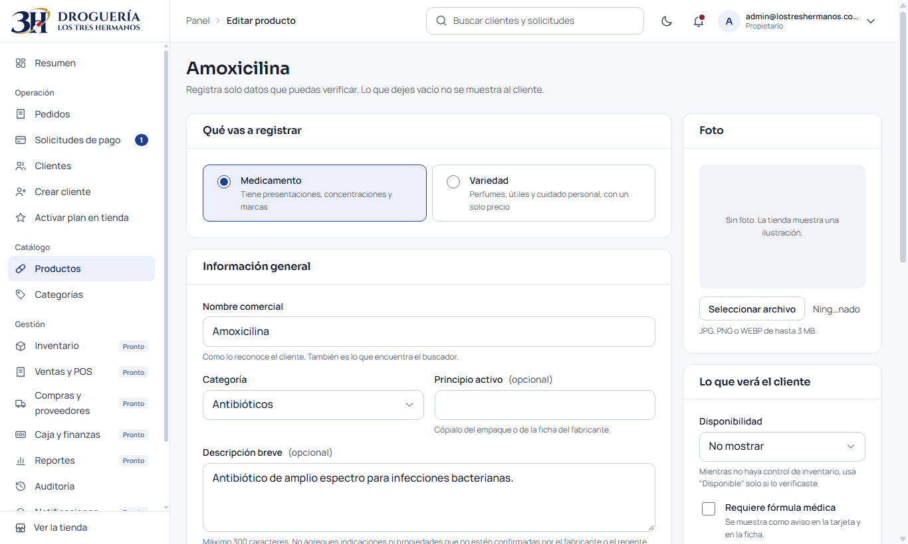
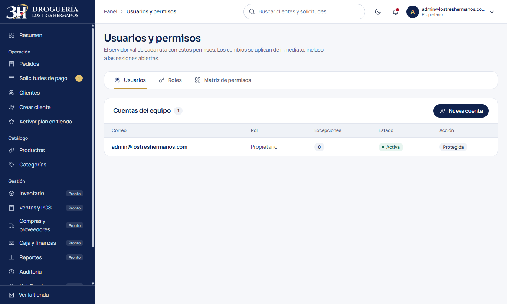
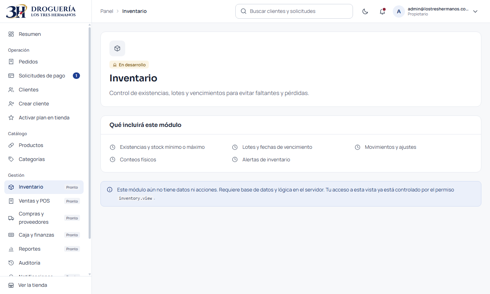
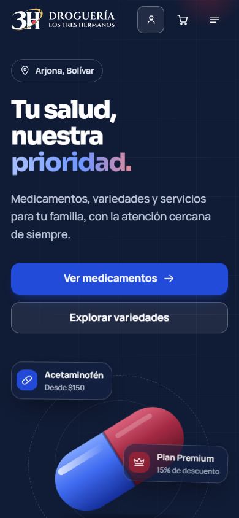
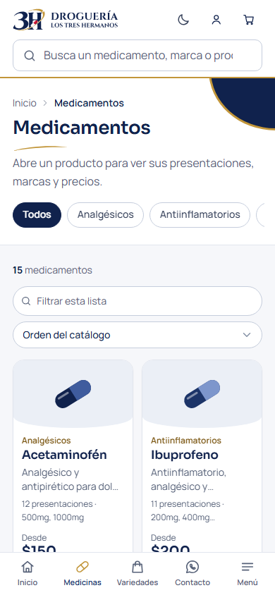
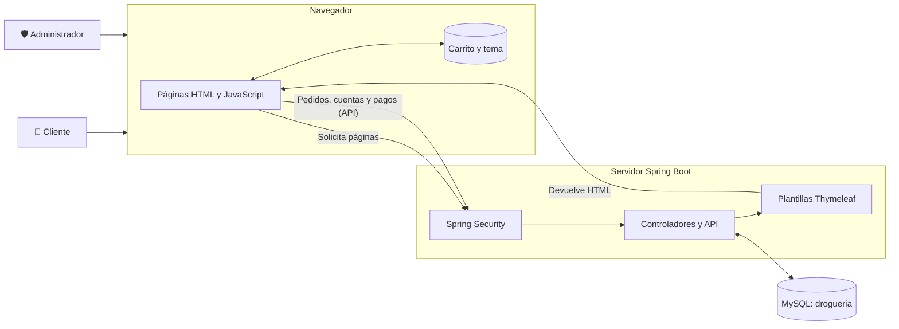
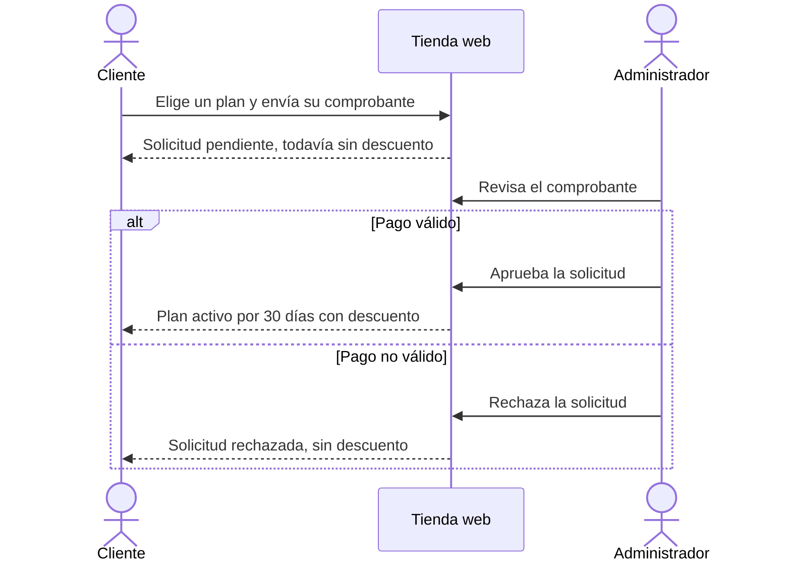

<div align="center">


# Droguería y Variedades Los Tres Hermanos

**Tienda web para una droguería de Arjona, Bolívar (Colombia): catálogo de medicamentos y variedades, pedidos en línea, planes de suscripción con descuento y panel de administración, sobre MySQL.**


**[Ver el sitio publicado](https://jhean1.github.io/DrogueriaYvariedadesLosTresHermanos/)**

[Capturas](#-capturas) · [Funcionalidades](#-funcionalidades) · [Arquitectura](#-arquitectura) · [Instalación](#-instalación-y-ejecución) · [Seguridad](#-seguridad) · [Limitaciones](#%EF%B8%8F-limitaciones-actuales)


</div>

## 📌 Sobre el proyecto

Este proyecto de aula lleva a la web la atención de una droguería de barrio. Un cliente puede explorar los productos, armar su carrito, elegir entre domicilio o recoger en tienda y hacer su pedido desde su cuenta. La droguería lo ve en el panel, lo prepara y lo entrega; el pago se hace en efectivo al recibirlo.

Los clientes también pueden suscribirse a un plan mensual para obtener descuentos. El administrador revisa los comprobantes de pago y activa los planes desde su panel.

> [!IMPORTANT]
> Las cuentas de clientes, los pedidos, los pagos de planes y el catálogo se guardan en MySQL (base `drogueria`). Antes de abrirla al público faltan decisiones del negocio, como las cuentas reales para recibir pagos en línea y el costo del domicilio. Consulta las [limitaciones actuales](#%EF%B8%8F-limitaciones-actuales).

## 📸 Capturas

> [!NOTE]
> Las capturas son de la aplicación real con **datos ficticios**. Las imágenes de productos son ilustraciones vectoriales propias, a la espera de las fotografías reales.

### Catálogo

| Medicamentos | Variedades |
|:---:|:---:|
|  |  |
| Búsqueda, filtros y selección de presentación, concentración y marca | Perfumes, útiles escolares y cuidado personal |

| Ficha de producto | Modo oscuro |
|:---:|:---:|
|  |  |

### Suscripciones y cuenta del cliente

| Planes de suscripción | Registro | Mi cuenta |
|:---:|:---:|:---:|
|  |  |  |

### Panel de administración

| Resumen | Revisión de un pago |
|:---:|:---:|
|  |  |

| Productos | Formulario de producto |
|:---:|:---:|
|  |  |

| Roles y permisos | Módulo en desarrollo | Acceso del equipo |
|:---:|:---:|:---:|
|  |  |  |

### En el celular

| Inicio | Medicamentos |
|:---:|:---:|
|  |  |

## ✨ Funcionalidades

### Para clientes

- 🔎 **Búsqueda central:** visible en toda la tienda, con sugerencias al escribir por nombre, marca, principio activo o categoría.
- 💊 **Catálogo:** tarjetas compactas y ficha de producto con presentación, concentración, marca y precio.
- 🌗 **Modo claro y oscuro:** interruptor visible que recuerda la preferencia, con movimiento sutil que respeta la opción de menos animación.
- 🖼️ **Imagen de cada medicamento:** el personal autorizado la agrega o cambia desde el catálogo.
- 🧭 **Guía de compra:** cuatro pasos en el inicio que se dibujan al bajar por la página.
- 🛒 **Carrito y pedido:** carrito persistente, entrega a domicilio o recogida en tienda. El servidor calcula precios y descuento con la base de datos.
- 🧾 **Recibo e historial:** recibo de cada pedido con su estado y consulta de compras anteriores desde **Mi cuenta**.
- ❤️ **Favoritos:** el cliente guarda productos desde su ficha y los ve en **Mi cuenta**.
- ⭐ **Suscripciones:** descuento automático en toda la tienda cuando el plan está aprobado y vigente.
- 💳 **Pago de planes:** efectivo en la tienda, o en línea con envío de comprobante por los medios que la droguería tenga configurados (Nequi, Daviplata, PSE o Bancolombia).
- 👤 **Cuenta personal:** foto, edición de datos, cambio de correo y contraseña, y eliminación de la cuenta (se borran los datos personales y se conservan las ventas sin ellos).

### Para administradores

- 📊 **Resumen:** indicadores y accesos rápidos según el rol.
- 🧴 **Productos y categorías:** crear, editar, retirar y volver a publicar medicamentos y variedades, con foto, validación y auditoría.
- 📦 **Pedidos:** búsqueda y filtros; preparar, marcar como entregado (descuenta el inventario por vencimiento) o anular con motivo.
- ✅ **Pagos:** revisión de comprobantes y aprobación, o rechazo con motivo que el cliente ve en su cuenta.
- 👥 **Clientes:** búsqueda y creación de cuentas.
- 🏪 **Pagos en tienda:** activación manual del plan cuando el cliente paga en efectivo.
- 🔑 **Usuarios y permisos:** crea roles y cuentas, asigna o revoca permisos por rol o por persona y activa o desactiva cuentas; Spring Security lo valida en cada petición.
- 🕵️ **Auditoría:** historial de inicios de sesión y cambios de accesos.
- 🧭 **Módulos planificados:** inventario, ventas, compras, caja, reportes, auditoría y notificaciones, marcados como *en desarrollo* y sin acciones simuladas.

### Planes de suscripción

| Plan | Precio mensual | Descuento | Domicilio prioritario | Ofertas anticipadas y acceso exclusivo |
|---|---:|:---:|:---:|:---:|
| 🌱 Básico | $4.900 COP | 3 % | — | — |
| 💊 Estándar | $9.900 COP | 5 % | — | — |
| 🏥 Regular | $14.900 COP | 10 % | ✅ | — |
| 👑 Premium | $19.900 COP | 15 % | ✅ | ✅ |

## 🛠️ Tecnologías

| Capa | Tecnología |
|---|---|
| Lenguaje | Java 21 |
| Framework | Spring Boot 4.1 (Spring MVC) |
| Seguridad | Spring Security, sesiones en el servidor y BCrypt |
| Vistas | Thymeleaf con fragmentos, HTML5, CSS3 y JavaScript sin frameworks |
| Diseño | Sistema de diseño propio con variables CSS; tipografías Sora y Manrope |
| Base de datos | MySQL 9.7 LTS con JdbcTemplate y HikariCP ([documentación](docs/base-de-datos/README.md)) |
| Construcción | Maven (incluye Maven Wrapper) |
| Pruebas | JUnit 5, Spring MockMvc y Spring Security Test |

## 🏗️ Arquitectura

El servidor entrega las páginas, guarda cuentas, pedidos y pagos en MySQL y protege el panel. El navegador solo guarda el carrito y el tema de color.



### Flujo de una suscripción



### Estructura del proyecto

```text
.
├── docs/base-de-datos/             # Diagramas, diccionario y scripts de MySQL
├── docs/imagenes/                  # Capturas de este README
├── pom.xml                         # Dependencias y construcción
└── src
    ├── main
    │   ├── java/com/example/DrogueriaLosTresHermanos
    │   │   ├── configuracion/      # Spring Security, filtros y propiedades del equipo
    │   │   ├── controlador/        # Controlador (MVC): rutas de la tienda y del panel
    │   │   ├── modelo/             # Modelo (MVC): datos, roles, permisos y módulos
    │   │   └── servicio/           # Catálogo, fotos, cuentas y permisos del equipo
    │   └── resources
    │       ├── application.properties
    │       ├── catalogo-inicial.properties  # Productos con los que arranca la tienda
    │       ├── static
    │       │   ├── css/            # design-system.css, tienda.css y admin.css
    │       │   ├── img/marca/      # Sistema de identidad 3H (SVG y PNG)
    │       │   └── js/             # Lógica, búsqueda, ficha de producto y tema
    │       └── templates/          # Páginas Thymeleaf y fragmentos compartidos
    └── test/java/...               # Pruebas automatizadas
```

### Rutas

| Ruta | Página | Acceso |
|---|---|---|
| `/` | Inicio | Público |
| `/medicamentos`, `/variedades` | Catálogos | Público |
| `/servicios`, `/nosotros`, `/contacto` | Información de la droguería | Público |
| `/suscripciones` | Planes | Público |
| `/registro`, `/login` | Cuenta de cliente | Público |
| `/perfil`, `/checkout`, `/recibo`, `/pago-suscripcion` | Área del cliente | Con sesión de cliente en el servidor |
| `/api/cuenta/**`, `/api/pedidos`, `/api/suscripciones/**` | API de la tienda | Con sesión de cliente (salvo registro e ingreso) |
| `/api/admin/**` | API del panel | **Según el permiso de cada acción** |
| `/admin/login` | Acceso de administrador | Público |
| `/admin` | Panel de administración | **Todo el equipo; cada sección según permisos** |
| `/admin/productos` | Lista de productos | **Con `products.view`** |
| `/admin/productos/nuevo` | Crear producto | **Con `products.create`** |
| `/admin/productos/{id}` | Editar producto | **Con `products.update`** |
| `/admin/productos/{id}/visibilidad` | Retirar o publicar | **Con `products.delete`** |
| `/admin/productos/{id}/foto` | Cambiar la imagen desde el catálogo | **Con `products.update`** |
| `/admin/categorias` | Categorías | **Con `products.update`** |
| `/js/catalogo.js`, `/productos/imagen/{foto}` | Catálogo publicado y fotos | Público |
| `/admin/modulos/{modulo}` | Módulos en desarrollo | **Según el permiso de cada módulo** |
| `/admin/accesos` | Usuarios y permisos | **Con `users.manage` o `roles.manage`** |
| `/admin/modulos/auditoria` | Historial de acciones | **Solo con `audit.view`** |

## 🚀 Instalación y ejecución

### Requisitos

- [JDK 21 o superior](https://adoptium.net/). No hace falta instalar Maven, porque el proyecto incluye Maven Wrapper.

### Pasos

**1. Clona el repositorio**

```bash
git clone https://github.com/jhean1/DrogueriaYvariedadesLosTresHermanos.git
cd DrogueriaYvariedadesLosTresHermanos
```

**2. Define la clave del administrador** (mínimo 12 caracteres)

```powershell
# Windows (PowerShell)
$env:ADMIN_CLAVE = "escribe-aqui-una-clave-larga-y-unica"
```

```bash
# Linux o macOS
export ADMIN_CLAVE="escribe-aqui-una-clave-larga-y-unica"
```

Si no la defines, la aplicación genera una clave temporal en cada arranque y la muestra en la consola.

**3. Inicia la aplicación**

```powershell
# Windows
.\mvnw.cmd spring-boot:run
```

```bash
# Linux o macOS
./mvnw spring-boot:run
```

**4. Abre el sitio**

- Tienda: <http://localhost:8081>
- Panel de administración: <http://localhost:8081/admin/login>

> [!NOTE]
> Para conectar MySQL, crea `datos/conexion.properties` con `app.db.url`, `app.db.usuario` y `app.db.clave` (esa carpeta no se sube a GitHub), o usa las variables `APP_DB_URL`, `APP_DB_USUARIO` y `APP_DB_CLAVE`. Sin conexión, la tienda muestra el catálogo y ofrece pedir por WhatsApp. La instalación de la base está en [docs/base-de-datos](docs/base-de-datos/README.md).

### Variables de entorno

| Variable | Descripción | Valor por defecto |
|---|---|---|
| `ADMIN_CORREO` | Correo para entrar al panel | `admin@lostreshermanos.com` |
| `ADMIN_CLAVE` | Clave del administrador (12 caracteres o más) | Se genera una temporal en cada arranque |
| `COOKIE_SEGURA` | Usa `true` si el sitio funciona con HTTPS | `false` |
| `APP_DATOS` | Archivo donde se guardan roles, cuentas del equipo y auditoría | `datos/accesos.properties` |
| `APP_CATALOGO` | Archivo del catálogo administrado desde el panel | `datos/catalogo.properties` |
| `APP_FOTOS` | Carpeta de las fotos que se suben desde el panel | `datos/fotos` |
| `APP_FOTOS_REPOSITORIO` | Imágenes del catálogo incluidas en el repositorio; se usan si la foto no está en `APP_FOTOS` | `fotos-productos` |
| `APP_DB_URL`, `APP_DB_USUARIO`, `APP_DB_CLAVE` | Conexión con MySQL | Lo de `datos/conexion.properties` |
| `APP_FOTOS_CLIENTES` | Carpeta de las fotos de perfil de los clientes | `datos/fotos-clientes` |
| `APP_COMPROBANTES` | Carpeta de los comprobantes de pago de planes | `datos/comprobantes` |
| `APP_EQUIPO_0_CORREO`, `APP_EQUIPO_0_ROL`, `APP_EQUIPO_0_CLAVE` | Miembro adicional del equipo. Usa 1, 2… para agregar más | Sin miembros adicionales |

Roles disponibles para `APP_EQUIPO_N_ROL`: `ADMINISTRADOR`, `REGENTE`, `CAJERO` y `AUXILIAR`. La cuenta de `ADMIN_CORREO` es la del propietario.

### Pruebas

```powershell
.\mvnw.cmd test    # En Linux o macOS: ./mvnw test
```

## 🔒 Seguridad

| Medida | Qué protege |
|---|---|
| Credenciales en variables de entorno y BCrypt | Evita que la clave del administrador aparezca en el código |
| Sesión en el servidor para `/admin` | Impide entrar al panel sin autenticarse |
| Roles y permisos en Spring Security | Bloquea con 403 cada ruta sin permiso, omite del HTML las secciones no autorizadas y aplica los cambios de inmediato, incluso en sesiones abiertas |
| Reglas contra la escalada de privilegios | Nadie concede permisos que no tiene ni modifica su propia cuenta o rol; el propietario es intocable |
| Protección CSRF | Rechaza formularios y peticiones a la API enviados desde otros sitios |
| Bloqueo tras 5 intentos fallidos durante 15 minutos | Frena los ataques de fuerza bruta contra el panel |
| BCrypt para las contraseñas de clientes y bloqueo tras 5 intentos | Las contraseñas no se guardan en texto plano ni en el navegador |
| Precios, descuentos y totales calculados en el servidor | Un carrito alterado en el navegador no cambia lo que se cobra |
| Escape de datos en HTML | Reduce el riesgo de XSS con nombres o pedidos manipulados |
| Lista de rutas de retorno permitidas | Evita redirecciones a sitios externos después del login |
| Precio del plan tomado de la base de datos | Impide aprobar un plan con precio o descuento alterados |
| CSP y otras cabeceras de seguridad | Limitan scripts externos y el envío de datos a otros dominios, y evitan que el sitio se inserte en otras páginas |

## ⚠️ Limitaciones actuales

- **Cuentas de pago sin configurar:** mientras la droguería no escriba sus cuentas reales en la configuración de la base, los planes solo se pagan en efectivo en la tienda.
- **Costo del domicilio en $0:** la droguería debe definirlo; hoy el recibo lo muestra como *por confirmar*.
- **La CSP permite scripts en línea:** las plantillas actuales los necesitan.
- **Accesos en un archivo local:** roles, cuentas del equipo y auditoría se guardan en `datos/accesos.properties`. Funciona con un solo servidor y un disco persistente; para crecer conviene pasarlo a una base de datos.
- **Los módulos de gestión están en desarrollo:** muestran su alcance, pero aún no tienen datos ni acciones.
- **Catálogo en un archivo local:** los cambios del panel se guardan en `datos/catalogo.properties` y las fotos en `datos/fotos`. Funciona con un solo servidor. La copia de GitHub Pages se genera con el catálogo inicial del repositorio, no con esos archivos.
- **Imágenes del catálogo:** 99 productos tienen su foto exacta y 272 una imagen de referencia, marcada así en la tienda; están en `fotos-productos/` y la relación con cada producto en `docs/base-de-datos/datos/imagenes-productos.csv`. Las imágenes provienen de catálogos públicos de tiendas colombianas; lo ideal es reemplazarlas por fotos propias desde el panel. Los productos restantes usan ilustraciones.

## 🗺️ Próximos pasos

- [ ] Subir las fotos de los productos desde el panel.
- [x] Incorporar una base de datos y una API en el servidor.
- [x] Validar cuentas, precios, pedidos y suscripciones en el servidor.
- [ ] Escribir las cuentas reales para recibir pagos de planes.
- [ ] Construir los módulos de inventario, ventas, compras, caja, reportes y auditoría.
- [ ] Publicar el sitio con HTTPS.

## 🌐 Publicación en GitHub Pages

Cada cambio en `master` ejecuta las pruebas, genera una copia estática de la tienda con `scripts/generar_sitio.py` y la publica en la rama `gh-pages`.

GitHub Pages solo sirve archivos estáticos, así que el sitio publicado funciona de esta forma:

| Función | En GitHub Pages | Con el servidor Spring Boot |
|---|---|---|
| Catálogo y carrito | ✅ | ✅ |
| Pedidos | Por WhatsApp | En línea, con recibo y seguimiento |
| Cuentas de cliente | ❌ No hay servidor | ✅ Guardadas en MySQL |
| Suscripciones | Se solicitan por WhatsApp | Formulario de pago con revisión en el panel |
| Panel de administración y roles | ❌ No se publica | ✅ |

Para generar el sitio en tu equipo:

```bash
./mvnw package -DskipTests
python scripts/generar_sitio.py --salida _sitio
```

## 🌿 Ramas

| Rama | Propósito |
|---|---|
| `master` | Versión principal del proyecto |
| `frontend` | Rediseño visual, identidad 3H y panel con roles |
| `gh-pages` | Sitio estático generado automáticamente; no se edita a mano |

## 👤 Autor

Desarrollado por [**@jhean1**](https://github.com/jhean1) como proyecto de aula.

---

<div align="center">

Droguería y Variedades Los Tres Hermanos · Arjona, Bolívar, Colombia

</div>
