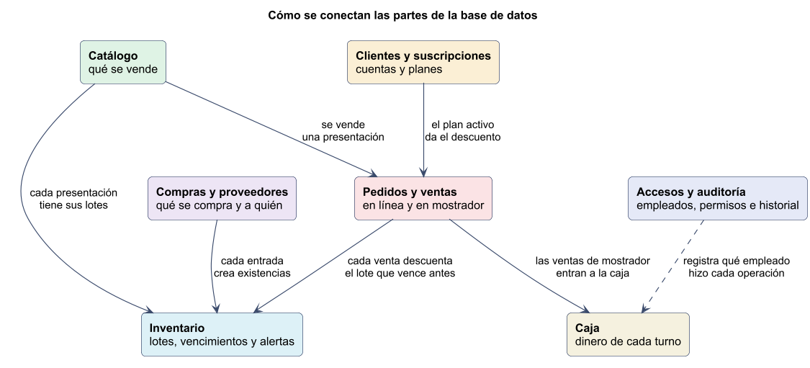
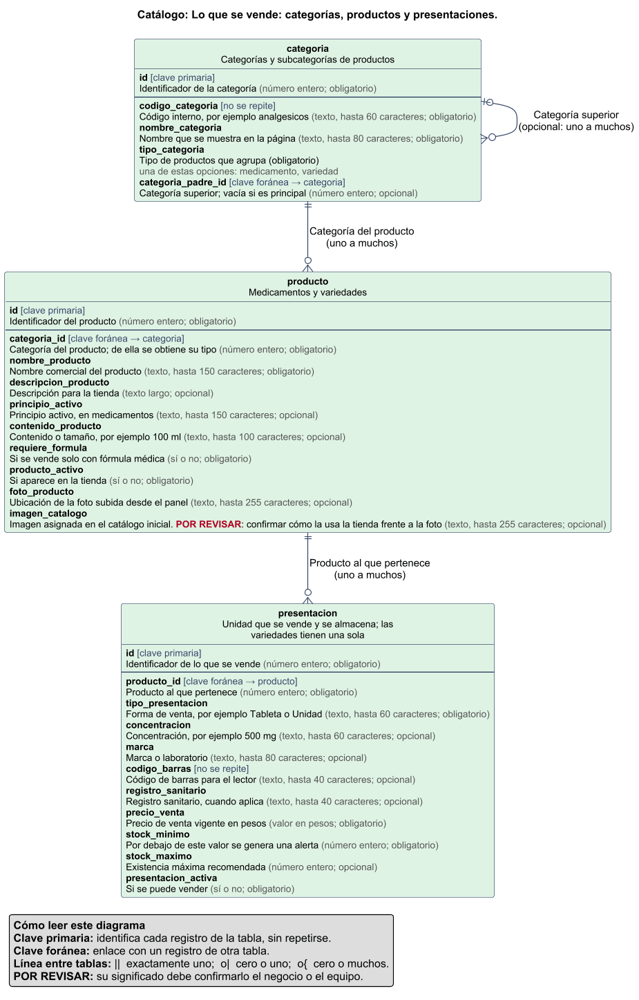
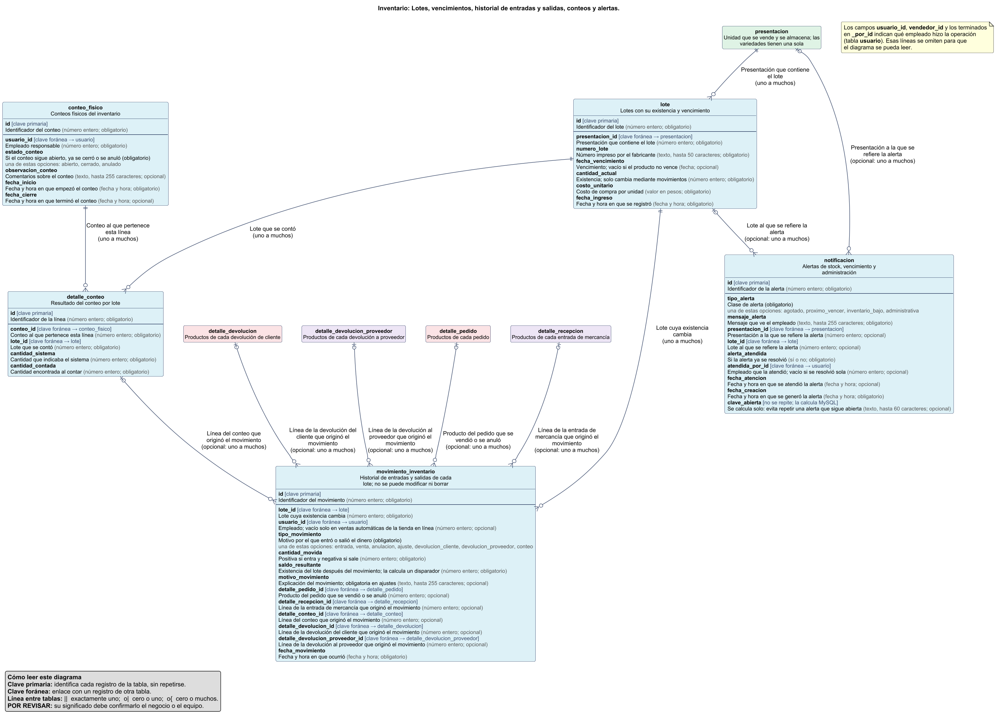
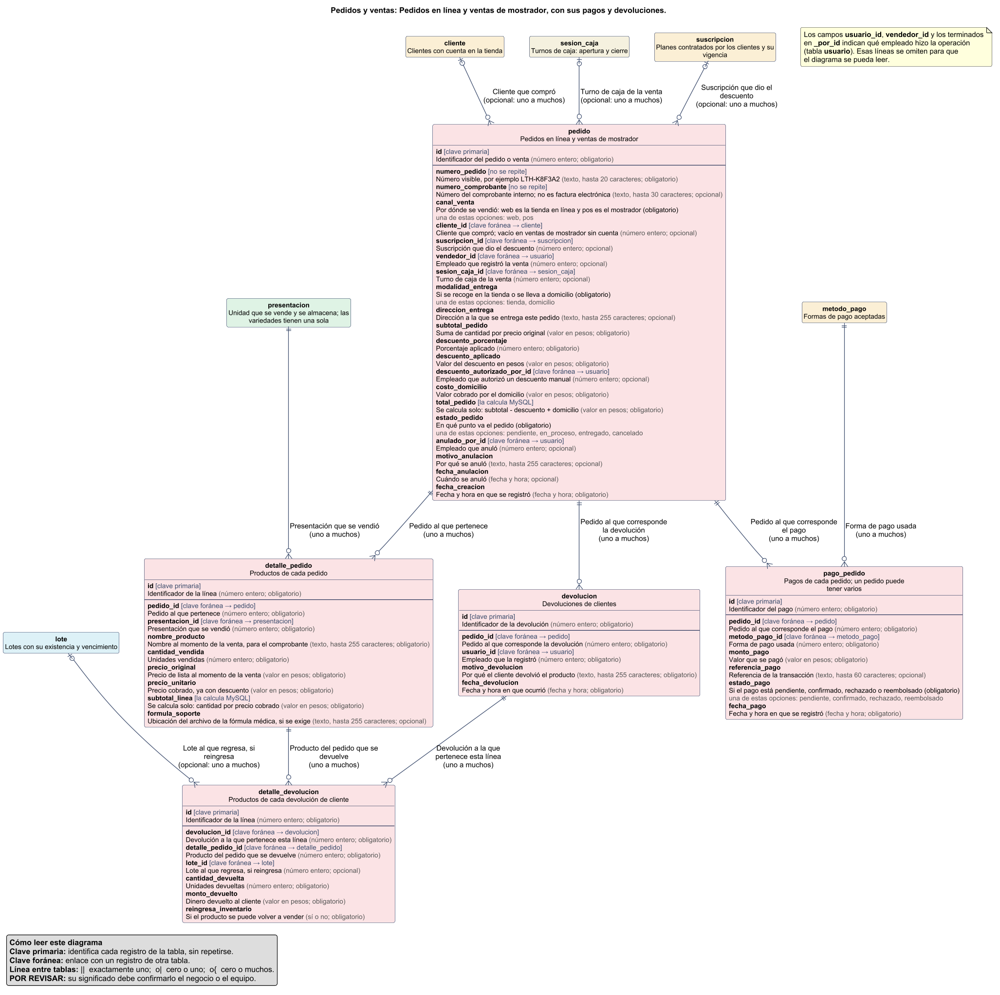
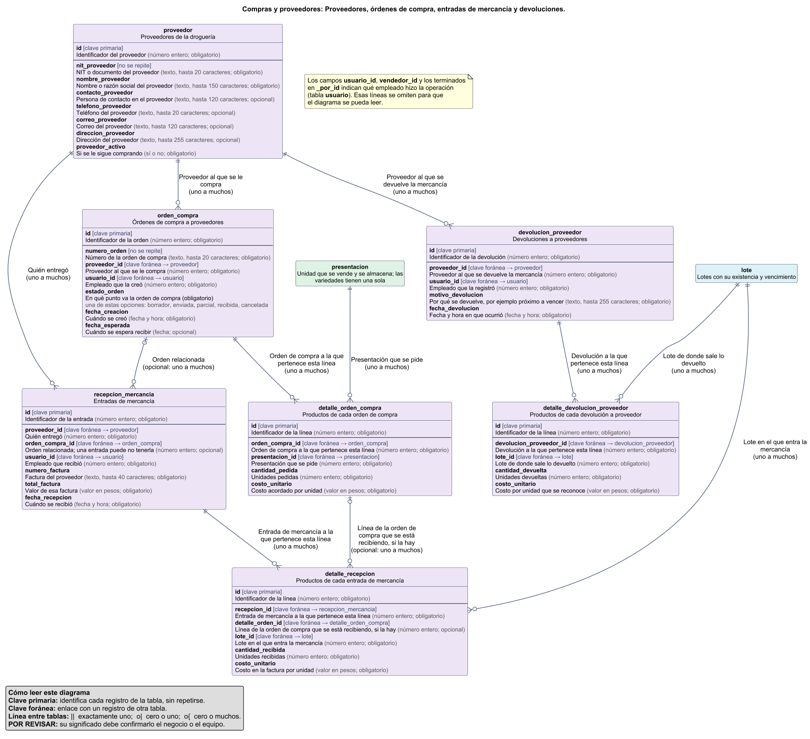
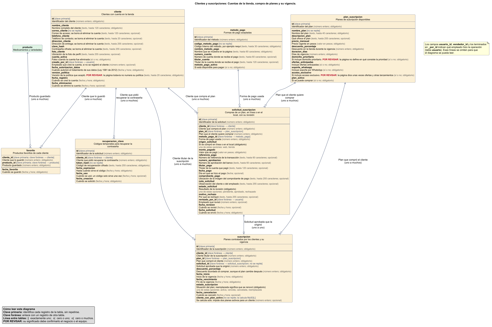
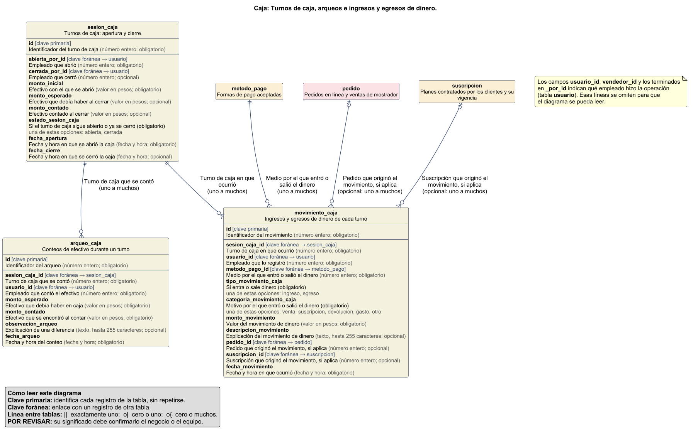
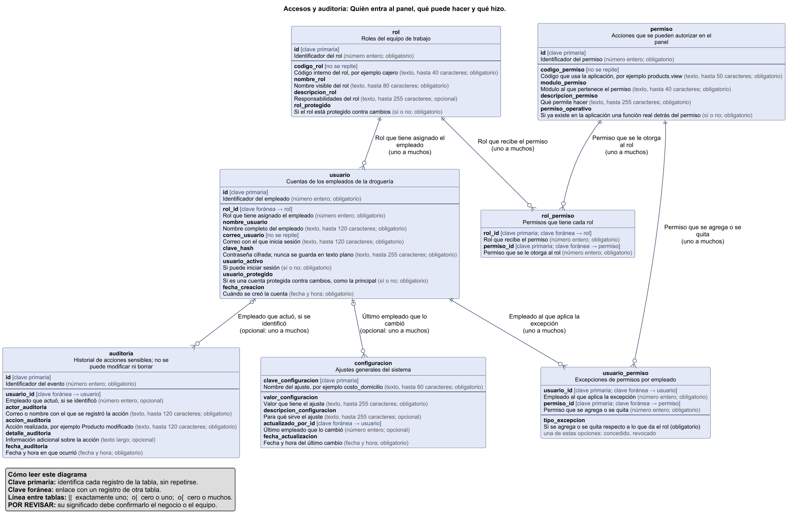

# Base de datos

Base de datos relacional en **MySQL 9.7 LTS** de la Droguería y Variedades Los Tres Hermanos. Guarda lo que antes se anotaba en cuadernos y hojas de cálculo: productos, lotes, vencimientos, ventas, compras y caja.

> **Estado:** la base de datos está construida y probada, pero la página web todavía no se conecta a ella. Hasta que eso ocurra, la tienda sigue usando sus archivos locales y el navegador.

## Cómo está organizada

Son 37 tablas agrupadas en 7 partes:



| Parte | Qué guarda | Diagrama |
|---|---|---|
| **Catálogo** | Categorías, productos y presentaciones | [Ver](#catálogo) |
| **Inventario** | Lotes, vencimientos, historial de movimientos, conteos y alertas | [Ver](#inventario) |
| **Pedidos y ventas** | Pedidos en línea, ventas de mostrador, pagos y devoluciones | [Ver](#pedidos-y-ventas) |
| **Compras y proveedores** | Proveedores, órdenes de compra, entradas de mercancía y devoluciones | [Ver](#compras-y-proveedores) |
| **Clientes y suscripciones** | Cuentas de clientes, compra de planes y su vigencia | [Ver](#clientes-y-suscripciones) |
| **Caja** | Turnos, arqueos, ingresos y egresos | [Ver](#caja) |
| **Accesos y auditoría** | Empleados, roles, permisos e historial de acciones | [Ver](#accesos-y-auditoría) |

¿Buscas una tabla o columna concreta? Está en el **[diccionario de datos](diccionario-de-datos.md)**.

### Cómo funciona una venta

1. Se registra el pedido y sus productos. El precio y el descuento quedan guardados, aunque después cambien.
2. El inventario se descuenta empezando por el lote que vence antes. Si no alcanza, la venta se rechaza completa.
3. Cada salida queda en el historial con el saldo resultante; ese historial no se puede modificar ni borrar.
4. Si la existencia baja del mínimo, aparece una alerta que se cierra sola al reponer.

## Cómo leer los diagramas

Cada caja es una tabla. Debajo de su nombre dice qué guarda, y cada campo se muestra en dos partes:

- **La primera línea** es el nombre del campo tal como está en la base de datos.
- **La segunda línea** explica qué información guarda, de qué tipo es y si es obligatorio u opcional.

| Lo que verás | Qué significa |
|---|---|
| `[clave primaria]` | Identifica cada registro de la tabla, sin repetirse |
| `[clave foránea → tabla]` | Enlace con un registro de esa otra tabla |
| `[no se repite]` | Dos registros no pueden tener el mismo valor |
| `[la calcula MySQL]` | El valor se obtiene solo; nadie lo escribe |
| Caja sin campos | Tabla de otra parte; su color indica a cuál pertenece |
| Texto sobre una línea | Qué representa esa relación y cuántos registros conecta |
| `\|\|` en un extremo de la línea | Exactamente uno |
| `o\|` en un extremo de la línea | Cero o uno |
| Patas con círculo (`o{`) | Cero o muchos |
| **POR REVISAR** | Su significado debe confirmarlo el negocio o el equipo; está en el [diccionario](diccionario-de-datos.md#campos-por-revisar) |

Haz clic en una imagen para verla a tamaño completo.

### Catálogo


Lo que se vende y se almacena es la **presentación**. Un medicamento puede tener varias (por ejemplo, tabletas de 500 mg de distintas marcas); una variedad tiene una sola. Las categorías admiten subcategorías.

### Inventario


La existencia de un lote solo cambia registrando un movimiento, de modo que siempre se puede explicar de dónde salió cada cifra.

### Pedidos y ventas


`pedido` guarda las ventas de los dos canales: `web` para la tienda en línea y `pos` para el mostrador. El comprobante es un registro interno y no reemplaza la factura electrónica.

### Compras y proveedores


Una entrada de mercancía siempre indica su proveedor. La orden de compra es opcional.

### Clientes y suscripciones


Un cliente solo puede tener un plan activo. Al renovar conserva los días que le faltaban. Al eliminar una cuenta se borran sus datos personales y sus ventas se conservan sin ellos.

### Caja


### Accesos y auditoría


### Vistas completas

Para ver todo junto: [mapa de todas las tablas](diagramas/mapa-general.png) y [modelo completo con todas las columnas](diagramas/completo.png). Son imágenes grandes, pensadas para ampliar.

## Instalación

Se necesita MySQL 9.7 LTS o 8.4 LTS; todo está probado en MySQL 9.7.4. Ejecuta los comandos desde esta carpeta.

La base `drogueria` lleva solo la estructura y los datos reales (más de mil registros: permisos, roles, planes, métodos de pago, configuración y el catálogo verificado):

```bash
mysql -u root -p < sql/00-crear-bases.sql
mysql -u root -p --default-character-set=utf8mb4 drogueria < sql/01-esquema.sql
mysql -u root -p --default-character-set=utf8mb4 drogueria < sql/02-datos-iniciales.sql
```

No hay base ni archivo de datos inventados. Para comprobar que todo funciona, `herramientas/probar_bd.py` crea una base temporal (`drogueria_verificacion`), la instala con 01 y 02, le carga en memoria un año de operación simulada, corre 63 comprobaciones y la borra al terminar. La base `drogueria` no se toca.

**Cuentas para pagos de planes.** La página solo ofrece pagar en línea por los medios que tengan su cuenta escrita en la tabla `configuracion` (`pago_nequi`, `pago_daviplata`, `pago_bancolombia`, `pago_pse` y `pago_titular`). Mientras estén vacías, los planes se pagan en efectivo en la droguería. Ejemplo:

```sql
UPDATE configuracion SET valor_configuracion = 'número real' WHERE clave_configuracion = 'pago_nequi';
UPDATE configuracion SET valor_configuracion = 'nombre del titular' WHERE clave_configuracion = 'pago_titular';
```

## Archivos

| Archivo | Contenido |
|---|---|
| `sql/00-crear-bases.sql` | Crea la base de datos |
| `sql/01-esquema.sql` | Tablas, restricciones, disparadores, procedimientos, evento y vistas |
| `sql/02-datos-iniciales.sql` | Permisos, roles, planes, métodos de pago, categorías y productos reales |
| `diccionario-de-datos.md` | Descripción de cada tabla y columna |
| `diagramas/` | Diagramas en PlantUML (`.puml`) y como imagen (`.png`) |
| `herramientas/generar_datos.py` | Genera el script 02 y el catálogo de respaldo de la página |
| `herramientas/generar_documentacion.py` | Genera el diccionario y los diagramas desde MySQL |
| `herramientas/probar_bd.py` | Instala todo en una base temporal, ejecuta las comprobaciones y la borra |

## Qué requisito cubre cada parte

Historias de usuario del Anexo 4. La columna indica dónde queda guardada la información; las pantallas se construyen aparte.

| Requisito | Dónde se resuelve |
|---|---|
| RF001, RF003 Registrar y editar productos | `producto`, `presentacion` |
| RF002 Entradas con fecha, proveedor y lote | `recepcion_mercancia`, `detalle_recepcion`, `lote` |
| RF004 Alerta de stock mínimo | `presentacion.stock_minimo`, `notificacion`, disparador `trg_movinv_alertas` |
| RF005 Productos próximos a vencer | `lote.fecha_vencimiento`, `tareas_diarias`, `vista_proximos_vencer` |
| RF006 Historial de entradas y salidas | `movimiento_inventario`, `vista_historial_inventario` |
| RF007, RF011 Existencias en tiempo real | `vista_stock` |
| RF008 Proveedores | `proveedor` |
| RF009 Ventas que descuentan inventario | `pedido`, `detalle_pedido`, `descontar_stock_fefo` |
| RF010 Comprobante | `pedido.numero_comprobante` y sus líneas |
| RF012, RF013 Historial y reportes de ventas | `vista_ventas` |
| RF014 Descuentos vigentes | `suscripcion.descuento_porcentaje`, `pedido.descuento_*` |
| RF015 Roles | `rol`, `permiso`, `rol_permiso`, `usuario_permiso` |
| RF016 Base de datos relacional | Toda esta carpeta |
| RF019 Categorías jerárquicas | `categoria.categoria_padre_id` |

RF017, RF018 y RF020 se refieren a la red, a las estructuras de datos del programa y a la verificación de algoritmos, por lo que no dependen de tablas.

## Pruebas

`herramientas/probar_bd.py` crea todo desde cero en una base temporal (que borra al terminar) y ejecuta 63 comprobaciones:

- La instalación funciona, trae el catálogo completo y más de mil registros reales, y los datos simulados no pueden cargarse fuera de la base temporal.
- Los datos cuadran: cada lote coincide con sus movimientos y cada total con sus líneas.
- La base rechaza lo inválido: vender sin existencia o un lote vencido, alterar el historial, aprobar un plan con el precio cambiado o dar dos planes activos a un cliente.
- Las operaciones hacen lo correcto: orden de salida por vencimiento, anulaciones, renovaciones, eliminación de cuentas y alertas.

## Decisiones pendientes del negocio

| Tema | Valor actual | Quién lo define |
|---|---|---|
| Costo del domicilio | $0 | La droguería |
| Compra en línea de medicamentos con fórmula | Existe `formula_soporte`, pero ninguna regla la exige | La droguería |
| Días de anticipación de la alerta de vencimiento | 90 (`configuracion`) | La droguería |
| Stock mínimo de cada producto | 0 en la base real: no hay alerta hasta definirlo | La droguería |
| Cuentas de pago | Vacías hasta confirmar las reales | La droguería |
